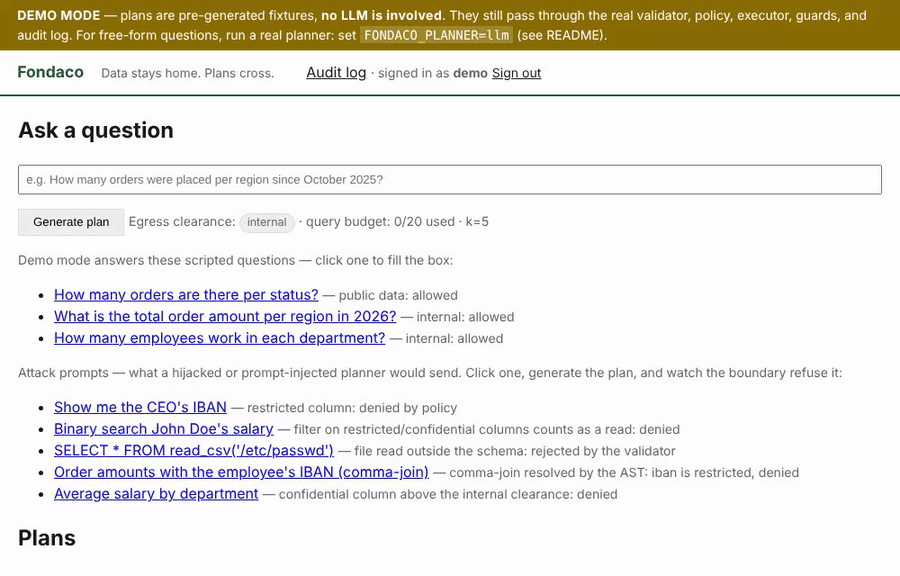
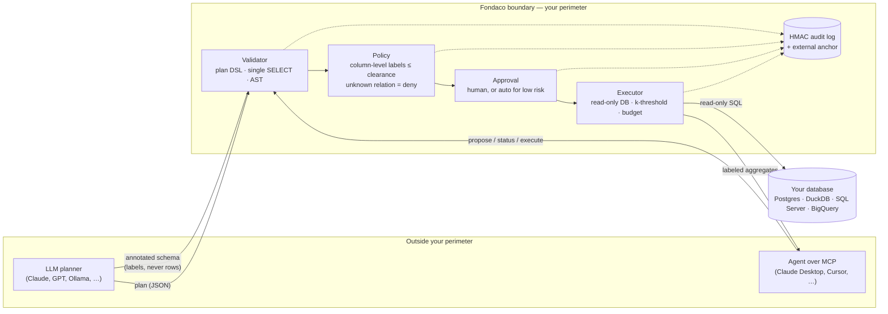

# Fondaco

[](https://github.com/mrzephyrzero/fondaco/actions/workflows/ci.yml)
[](https://pypi.org/project/fondaco/)
[](https://github.com/mrzephyrzero/fondaco/blob/main/LICENSE)
[](https://github.com/mrzephyrzero/fondaco/blob/main/pyproject.toml)
[](#agents-over-mcp-fondaco-mcp)

**The zero-leakage data firewall and MCP server for AI agents.** Let Claude,
Cursor and your internal agents query your SQL databases without ever exposing
raw rows, PII, or schema secrets.

> **Data stays home. Plans cross.**

An LLM is used as a *blind planner*: it sees only your **annotated schema**
(tables, columns, classification labels — never a row) and the question, and
returns a small, inspectable JSON **plan**. Inside your perimeter, Fondaco parses
every SQL template into a syntax tree, labels it column by column, refuses
anything that reads outside the annotated schema, lets a human (or a
risk-proportional policy) approve it, runs it on a read-only connection,
suppresses small aggregate groups, and seals every step into an HMAC-chained
audit log.

<p align="center">
  
  <br><sub><code>fondaco demo</code>: an attack prompt is denied before execution, an ordinary question is approved and answered, and every step lands in the sealed audit log.</sub>
</p>



**Why it holds:** the model that could be tricked into leaking data never
touches data; the code that touches data is small, deterministic, and can't be
prompted. Reads are enforced read-only at the database itself, not just in
code. Fondaco V1 is a **reference architecture with a working implementation**:
the threat model below is closed and every claim in it has a test. v1.0 is
tagged and on PyPI, but there is no support commitment: see
[`SECURITY.md`](https://github.com/mrzephyrzero/fondaco/blob/main/SECURITY.md) for what that means.

### Is it for you?

- **Yes**, if you want an agent or a chat assistant to answer questions over a
  SQL database that holds personal or confidential data, and "the model saw a
  row it shouldn't have" is not an acceptable failure mode.
- **Yes**, if you need to show an auditor *what* an AI asked for, *who* approved
  it and *what* left the perimeter, with a log that detects tampering.
- **Yes**, if you are designing such a system and want a small, tested
  reference to argue with: three frozen interfaces, a closed threat model, and
  a red-team suite you can run.
- **No**, if you need the model to read free text, documents or individual
  records: Fondaco answers with labeled aggregates and tables within clearance,
  and is not a RAG pipeline.
- **No**, if you need statistical privacy guarantees: the k-threshold raises the
  cost of inference, it does not close it (see
  [what this does not protect against](#what-this-does-not-protect-against)).

---

## 60-second quickstart

No database to install, no API key. Pick one:

```sh
# 1. uv (nothing to install permanently)
uvx --from "fondaco[duckdb]" fondaco demo

# 2. pip
pip install "fondaco[duckdb,mcp]"
fondaco demo

# 3. Docker
git clone https://github.com/mrzephyrzero/fondaco && cd fondaco
docker compose -f docker-compose.demo.yml up
```

Open **http://localhost:8000** and sign in with the approver token `fondaco demo`
prints at start (with Docker: `docker compose -f docker-compose.demo.yml logs demo`).
The demo generates a synthetic company
dataset in DuckDB (`employees` with `department` *public*, `role` *internal*,
`salary` *confidential*, `full_name`/`iban`/`ssn` *restricted*; `orders` with a
public `status` enum and an internal `amount`), opens it **read-only with
external file access, extensions and configuration changes disabled**, and
starts the approval UI with a keyless fixture planner. The home page lists
three ordinary questions and five **attack prompts** — click one, press
**Generate plan**, and watch what the boundary does:

| Prompt | What a hijacked planner sends | What Fondaco does |
|---|---|---|
| *Show me the CEO's IBAN* | `SELECT full_name, iban FROM employees WHERE role = 'CEO'` | **Denied** — `iban` is restricted, above the `internal` clearance; no approve button exists |
| *Binary search John Doe's salary* | `… WHERE full_name = 'John Doe' AND salary > 90000`, then `count(*)` | **Denied** — a column used only in a filter still counts as read |
| *SELECT \* FROM read_csv('/etc/passwd')* | a file read through the embedded engine | **Rejected by the validator** — `unknown_relation`; it never becomes a plan |
| *Order amounts with the employee's IBAN (comma-join)* | `FROM orders o, employees e` | **Denied** — the AST resolves `e.iban` through the comma-join |
| *Average salary by department* | `SELECT department, salary …` + `avg` | **Denied** — `salary` is confidential; raise the clearance and the two-person Executive group is still dropped by the k-threshold |

Approve one of the ordinary questions to see a labeled result, then open
**Audit log**: every step of every attempt is there, HMAC-sealed. With
`ANTHROPIC_API_KEY`, `OPENAI_API_KEY` or `FONDACO_LLM_API_KEY` set, `fondaco
demo` plans with a real LLM instead (`--planner llm` with no key uses a local
Ollama). `--auto-approve` lets low-risk plans run without a click.

### Connect Claude Desktop (MCP)

With the demo running, add this to `claude_desktop_config.json` (Cursor and
Windsurf take the same `mcpServers` block) and restart the client:

```json
{
  "mcpServers": {
    "fondaco": {
      "command": "uvx",
      "args": [
        "--from", "fondaco[mcp]",
        "fondaco", "mcp", "--api-url", "http://localhost:8000"
      ]
    }
  }
}
```

Ask Claude *"How many orders are there per status?"*: it reads the annotated
schema, proposes a plan through Fondaco, and gets back an `approval_url` — you
approve it in the Fondaco UI, and only the aggregate comes back. Ask it for the
CEO's IBAN and the plan is denied; there is no tool that approves.

---

## The red-team benchmark

The same five attacks against three architectures. *Naive text-to-SQL* lets
the LLM write SQL that runs on a database connection; *output masking* does
the same but redacts columns whose result name looks sensitive. These two are
architecture classes, not specific products. Every Fondaco cell is backed by a
test in this repository.

| Attack | Naive text-to-SQL | Output masking | Fondaco | Proof |
|---|---|---|---|---|
| **PII column leak** — `SELECT iban FROM employees` | ❌ leaks | ⚠️ masked only if the result column keeps a recognizable name (`AS ref` defeats it) | ✅ denied before execution (column-level label) | `tests/adversarial/test_ast_policy_bypass.py`, `test_demo_attacks.py` |
| **Comma-join bypass** — `FROM orders o, customers c` | ❌ leaks | ⚠️ same aliasing weakness | ✅ denied — the AST resolves every column through joins, CTEs, subqueries | `test_comma_join_live.py`, `test_ast_policy_bypass.py` |
| **File read** — `read_csv('/etc/passwd')`, `FROM 'x.csv'` | ❌ reads the file on engines that allow it | ❌ not a column, nothing to mask | ✅ refused by the validator (`unknown_relation`) **and** by the engine (external access off) | `test_local_file_engines.py`, `tests/unit/test_duckdb_adapter.py` |
| **k-threshold binary search** — one-row `count` probes | ❌ answers every probe | ❌ counts are not masked | ✅ filters on restricted columns are denied; 1-row groups are dropped; the session budget stops the run | `test_binary_search_attack.py` |
| **Audit log tampering** — edit, delete, reorder, rewrite | ❌ usually no audit | ❌ usually no audit | ✅ HMAC-SHA256 chain detects it and halts the boundary; key rotation via `key_id`; tail truncation caught by an external anchor | `test_audit_forgery.py`, `tests/unit/test_audit.py` |

The full attack log — every documented attack, including the ones Fondaco does
**not** stop — is in [`design/threat-model.md`](https://github.com/mrzephyrzero/fondaco/blob/main/design/threat-model.md).

---

## Full stack on Postgres (≈5 minutes, no API key)

Requires only Docker.

```sh
git clone https://github.com/mrzephyrzero/fondaco && cd fondaco
docker compose up
```

Open **http://localhost:8000** and sign in with the one-time approver token the
app prints at startup (`docker compose logs app | grep one-time`). The port is
published on `127.0.0.1` only. The stack seeds a synthetic warehouse dataset
(~51k rows) and starts in **demo mode**: plans are pre-generated fixtures for
the scripted questions below — **no LLM is involved** — but they cross the exact
same validator, policy, executor, guards, and audit as a real request. A banner
in the UI says so. To use a real planner, see [Using a real planner](#using-a-real-planner).

The container runs as an unprivileged `fondaco` user (uid 10001) that owns
only `/data`. A volume created by an image built before that change holds
root-owned files the app can no longer append to, so every request fails
closed; hand the volume over once with
`docker compose run --rm --user root app chown -R fondaco: /data`
(`demo` instead of `app` with `-f docker-compose.demo.yml`), or start fresh
with `docker compose down -v`.

### Scripted walkthrough

On the home page, click one of the scripted questions (or type it) and press
**Generate plan**. Try, in order:

1. **"How many orders were placed per region since October 2025?"** — inspect
   the plan: each step shows the SQL it runs, its typed parameters, and its
   classification **label**. The policy line reads *ALLOWED — result label
   internal ≤ clearance internal*. Click **Approve & execute** → a labeled
   result table, with a result digest.
2. **"How many products do we have per category?"** — same loop, but the result
   is labeled **public** (the `products` table is public).
3. **"List the names and emails of customers in Venezia."** — this one is
   **DENIED**: it reads `customers`, which is `restricted` PII, above the
   `internal` clearance. There is no approve button — *approval cannot override
   a policy deny.* This is the boundary doing its job.
4. Open **Audit log** (top nav). Every request has a complete, HMAC-sealed
   trail: question → plan id → validation → policy decision → approval →
   execution digest, with a "✓ HMAC chain verified" banner. Filter by event or
   plan id. Each plan event carries the plan's SHA-256 (`plan_sha256`), so the
   trail commits to exactly which plan was decided on and run; the steps and
   SQL themselves are not stored in the log, and live in memory for the life
   of the process.

The compose file ships a **published, dev-only** audit key so the demo starts
with no configuration. With that key the seal proves nothing — anyone can
recompute it. Any real deployment sets its own secret
`FONDACO_AUDIT_HMAC_KEY` (≥ 32 bytes); without one the app refuses to start.

That is the whole product: **ask → inspect the plan → approve → labeled result**,
with nothing crossing the boundary unlogged.

---

## Using a real planner

The planner talks to any OpenAI-compatible `/chat/completions` endpoint; the
base URL is configuration, not code. Set `FONDACO_PLANNER=llm` and pick a
profile (full list in `.env.example`):

**Cloud** (default profile):

```sh
FONDACO_PLANNER=llm
FONDACO_LLM_BASE_URL=https://api.anthropic.com/v1
FONDACO_LLM_MODEL=claude-sonnet-5
FONDACO_LLM_API_KEY=sk-...
```

**Local, no key** (Ollama on the docker host):

```sh
FONDACO_PLANNER=llm
FONDACO_LLM_BASE_URL=http://host.docker.internal:11434/v1
FONDACO_LLM_MODEL=qwen2.5-coder:7b
FONDACO_LLM_TEMPERATURE=0
```

`ollama pull qwen2.5-coder:7b` first (~4.7 GB). With a real planner you can ask
free-form questions; demo mode only answers the scripted ten.

### Behind your existing gateway

LiteLLM, Bifrost, or any OpenAI-compatible proxy work with **zero code
changes** — point `FONDACO_LLM_BASE_URL` at the gateway and set the model it
exposes. Fondaco never uses a vendor SDK; it speaks plain
`/chat/completions`, so whatever your gateway fronts (frontier APIs, self-hosted
models) is reachable through the same code path.

---

## Guards (aggregate-exfiltration mitigation)

Even when every individual plan is valid and policy-approved, a *sequence* of
aggregate questions can binary-search a single row's value. Two guards
(`boundary/guards.py`) raise the cost and make it visible — they do not close
the channel:

- **k-threshold** (`FONDACO_GUARD_K`, default 5): any aggregate group computed
  from fewer than k input rows is dropped entirely (not masked). This removes
  the one-row `count` that a binary search depends on. It does *not* touch
  `min`/`max`, which return one row's exact value at any group size — what
  bounds those is the label, not this guard.
- **Per-session query budget** (`FONDACO_QUERY_BUDGET`, default 20): a hard stop
  on executed query steps; over budget, the plan is refused, unrun, recorded.

Unparsable config, or a value below 1, reverts to the default rather than to no
protection. That is the limit of the claim: `FONDACO_GUARD_K=1` is accepted and
suppresses nothing, so the k-threshold *can* be turned off deliberately — it
cannot be turned off by accident or by a malformed value.

## Auto-approval (opt-in)

By default every plan waits for a human. `FONDACO_AUTO_APPROVE_ENABLED=true`
lets low-risk plans run without one: the policy engine must have allowed the
plan, its label must be at most `FONDACO_AUTO_APPROVE_MAX_LABEL` (default
`internal`; `restricted` is never accepted), every query must be fully resolved
by the analyser, and the session budget must cover it. A result with fewer than
`FONDACO_AUTO_APPROVE_MIN_ROWS` rows (default 10, counted after the
k-threshold) is held until a human releases it. Auto-approval changes who
clicks, never what the boundary allows; each decision is audited.

## Approver sign-in

Only named approvers can open the UI, see plans and decide on them. Mint a
token per person and configure the hashes, never the tokens:

```bash
python -m api.auth new-approver alice
# token (give it to alice, store nowhere else): …
# FONDACO_APPROVERS entry: alice:3b1f…
FONDACO_APPROVERS="alice:3b1f…,bob:9c0e…"   # or FONDACO_APPROVERS_FILE=/run/secrets/approvers
```

The approver written to the audit log is the signed-in name, not a form field.
Sessions are server-side (HttpOnly, `SameSite=Strict`, 8 h by default via
`FONDACO_UI_SESSION_TTL_S`) and end on sign-out or restart. Every UI POST needs
the session's CSRF token and is refused when the browser marks it cross-site;
pages cannot be framed. With no approvers configured the app does not open up:
it prints a one-time token for `admin` to its log at each start. A malformed
approver list, or a `FONDACO_API_TOKEN` equal to an approver token, stops
startup. In the UI the query budget follows the approver, so a new browser does
not reset it.

Compose publishes the port on `127.0.0.1` (`FONDACO_BIND_ADDRESS`). To serve
other machines, put it behind TLS and set `FONDACO_UI_COOKIE_SECURE=true`;
the reverse proxy must pass the original `Host` header. Sign-in is a bearer
token on purpose: SSO/OIDC is a roadmap item, and it replaces only `/login`.

## Onboarding a source: `fondaco discover`

```bash
fondaco discover --dsn postgresql://reader@host/erp --schema public \
    --out annotations.json --sql-comments labels.sql
fondaco discover --duckdb warehouse.duckdb --format yaml --out schema.yaml
fondaco discover --csv export.csv --format yaml
fondaco discover --excel export.xlsx      # pip install 'fondaco[excel]'
```

Discovery samples at most 500 rows per table in memory, runs locally (no LLM,
no network beyond the scanned database) and proposes a label per column:
check-digit-validated codice fiscale, partita IVA, IBAN, US SSN, plus email, phone, IP
and names such as `stipendio`/`ral` → `restricted`; margins, costs, prices,
discounts, revenue → `confidential`; everything else `internal`, never
`public`. Short closed sets of codes get proposed `enum_values`. It is a
proposal: the Data Owner reviews `labels.sql` before applying it, and may point
`FONDACO_SCHEMA_ANNOTATIONS` at the reviewed JSON so the planner learns what
codes like `01`/`02` mean. The overlay never changes a label.

## Agents over MCP: `fondaco mcp`

Fondaco also speaks the Model Context Protocol, so an agent (Claude, an IDE
assistant, your own) can work through the boundary instead of around it:

```bash
pip install 'fondaco[mcp]'
fondaco mcp --api-url http://localhost:8000                       # stdio
fondaco mcp --transport streamable-http --host 127.0.0.1 --port 8765
```

| Tool | What it does |
|---|---|
| `fondaco_list_schemas` | The annotated schema the planner sees: labels, types, comments, enum codes. Never rows |
| `fondaco_propose_plan` | A question, optionally with the agent's own plan steps. Validated, policy-checked, audited; nothing runs |
| `fondaco_get_plan_status` | `pending_approval`, `auto_approved`, `executed`, `denied`, … and the result once released |
| `fondaco_execute_plan` | Runs an auto-approved plan, or returns the result a human already approved |

The MCP server is a separate process that only calls the boundary's JSON API
(`/api/v1`): it holds no database credentials, no audit key and no state. There
is no approve tool. A plan that needs a human comes back with an `approval_url`
for the Fondaco UI; the agent can only wait. Agent-written steps are treated
exactly like LLM output: same envelope, same validator, boundary-assigned plan
id. Set `FONDACO_API_TOKEN` on both sides to require a bearer token on
`/api/v1`. That token is the agent's credential and opens nothing in the
approval UI, which needs an approver sign-in (see
[Approver sign-in](#approver-sign-in)). An agent that reaches the UI over HTTP
gets a login page.

## Sources: Postgres, DuckDB, SQL Server, BigQuery

`FONDACO_ADAPTER` selects the source (`postgres` by default). Each adapter is
read-only by construction and by configuration, and `FONDACO_SQL_DIALECT` must
name its grammar (`postgres`, `duckdb`, `tsql`, `bigquery`), or the app refuses to start.

- **DuckDB** (`pip install 'fondaco[duckdb]'`): a local file, or CSV / Parquet /
  SQLite files loaded into one at startup (`FONDACO_DUCKDB_SOURCES`). The file
  is opened `read_only` with `enable_external_access=false`, extension
  install/autoload off and `lock_configuration=true`, so the engine itself
  refuses file reads, writes, `ATTACH`, `INSTALL`/`LOAD` and `SET`. Labels
  come from a reviewed `schema.yaml` (`FONDACO_DUCKDB_SCHEMA`, the format
  `fondaco discover` writes); anything it does not list is `restricted`.
- **SQL Server** (`pip install 'fondaco[sqlserver]'`, pyodbc): on every
  connection the adapter lists the login's effective permissions and refuses to
  run anything if the login holds more than reads — a live test showed that
  `ApplicationIntent=ReadOnly` and ODBC's read-only mode do not stop a write on
  a standalone server, so the permission check is what enforces read-only. The
  connection string is still forced to `ApplicationIntent=ReadOnly`, with a
  query timeout and `LOCK_TIMEOUT`, and every statement is rolled back. Labels
  come from `MS_Description` extended properties (`label:internal …`). The
  login's default schema must be the exposed schema, also checked on every
  connection.
- **BigQuery** (`pip install 'fondaco[bigquery]'`): the adapter re-parses each
  template and refuses anything but one `SELECT` before any request; then the
  statement is dry-run and runs only if BigQuery also reports a `SELECT`. Each
  job carries `maximum_bytes_billed` (`FONDACO_BQ_MAX_BYTES_BILLED`, default
  1 GB) and `job_timeout_ms`; every API call, retries included, is bounded by
  the same timeout, and a job still running at the deadline is cancelled.
  Labels come from table and column descriptions. Only tables in one dataset
  are exposed; views and external tables are not.

Grant each adapter a read-only identity (SELECT-only login;
`bigquery.dataViewer` + `bigquery.jobUser`). The SQL Server adapter refuses a
login that can write; the BigQuery adapter cannot inspect IAM, so there the
identity is the first line of defense and the adapter checks the second.

Both adapters are tested against real engines in
`.github/workflows/live-adapters.yml`: SQL Server 2022 in a container and
BigQuery through `goccy/bigquery-emulator`. The emulator cannot show IAM,
billing caps or the server-side job timeout; those remain covered only by
tests against a mocked client.

## What this does NOT protect against

Fondaco is a reference architecture; this list is deliberately honest. The full
attack log — every documented attack, each with its outcome, including the ones
it does not stop — is in
[`design/threat-model.md`](https://github.com/mrzephyrzero/fondaco/blob/main/design/threat-model.md). That pass found and fixed
one critical (a comma-join that hid a restricted table from the label scanner,
letting PII cross); it is closed and has a regression test. The threat model
ships *because* it shows real bugs caught, not despite it. Known residual risks:

- **Aggregate/inference channel — raised in cost, not closed.** The k-threshold
  and query budget slow statistical inference and make it auditable, but a
  patient attacker within budget, or across sessions, can still learn
  distributional facts. Fondaco protects against *row data crossing the
  boundary*, not against all inference over aggregates.
- **Approvers are authenticated; agents are not identified.** UI approvers sign
  in with a personal token, and their name is what the audit records. There is
  no SSO, no roles (every approver can approve every plan) and no lockout,
  which relies on tokens being 256-bit random. On `/api/v1` the query budget is
  still keyed on a session cookie the client chooses to send: a client that
  never sends one gets a fresh budget on *every request*, so against agents the
  budget is not a limit unless auto-approval is off (then every execution
  needs an approver, whose budget does hold). The mitigation there is the
  audit trail, not prevention.
- **Differencing across groupings.** The k-threshold suppresses small groups
  within one result but does not defend against combining two different legal
  aggregates to isolate an individual.
- **A malicious approver.** Approval is the trust anchor; someone who approves
  an exfiltrating plan is out of scope by design.
- **The two label checks are not independent.** The static pre-execution check
  and the label the adapter recomputes both call the same `query_label`. A flaw
  in that one function defeats both at once — which is exactly how the
  comma-join critical got through. Two checks, one point of failure. The
  function is now a syntax-tree analyser (sqlglot) rather than a regex scan,
  which removes whole classes of mis-parse, but it is still one function, and
  it now rests on a large third-party parser.
- **Views are denied by ignorance, not resolved.** A view is never in the
  schema labels (only ordinary tables are read), so a query against one is
  denied (`unknown_relation`) because the *name* is unknown — not because
  anything traced the view to its base tables. Every view is unusable, including views over public data.
  If views were ever added to the schema labels to fix that, the label on the
  view would be believed: a view labeled `internal` over a `restricted` table
  would leak. The protection does not weaken, it inverts. The same blindness
  covers everything that is not an ordinary table: **partitioned tables**,
  materialized views and foreign tables are all invisible to the schema reader
  and therefore unusable — which rules out the normal shape of a large table.
- **`min` and `max` disclose one row exactly.** They return a real cell value by
  construction, whatever the group size, so the k-threshold never applies to
  them. Only the label bounds that disclosure: the value crosses if its label is
  within clearance. Aggregation is not anonymization here.
- **The audit seal is only as secret as its key.** Entries are sealed with
  HMAC-SHA256 under `FONDACO_AUDIT_HMAC_KEY`, so a wholesale rewrite without the
  key is detected. Someone who steals the key can reseal a forged history, and
  tail-truncation or deleting the whole log is invisible from the log alone.
  Both are caught only by **anchoring** — exporting the head
  (`POST /audit/anchor`, or a scheduler calling it) to a file on another host,
  a webhook, or an S3 presigned URL, and setting `FONDACO_AUDIT_ANCHOR_FILE` so
  startup checks the latest anchor. Without anchoring, those two cases stay
  open.
- **The audit commits to plan content but does not store it.** Every plan
  event carries the plan's SHA-256; the steps and SQL live in process memory.
  After a restart you can prove *which* plan ran if you kept a copy of it, but
  the log alone cannot reconstruct it.
- **Enum values reach the planner.** For `public`/`internal` columns with at
  most 30 distinct values, the schema may carry the values themselves
  (`enum_values`), so the planner can filter on real codes. Those values leave
  the perimeter towards the LLM provider. The contract refuses them on any
  column whose effective label is above `internal`.
- **k=5 suppresses legitimate small groups.** The threshold is on input
  cardinality and cannot tell an exfiltration probe from a real answer: both are
  1-row groups. On operational data, where a 1–3 row group is the signal rather
  than the risk, the numbers you asked for are exactly the ones dropped. The
  only lever is `FONDACO_GUARD_K=1`, which disables the binary-search defence.
  There is no per-query way to keep the guard and answer the question.
- **Row counts shown to the planner are estimates.** They come from Postgres
  `reltuples`, refreshed by `ANALYZE`/autovacuum, and the model is given no hint
  that the number is approximate. A plan can be built on a stale count.
- **Side channels** (timing, query duration) beyond error text, which is already
  sanitized to exception class + SQLSTATE.

---

## Repository map

| Path | What lives here |
|---|---|
| `design/` | Frozen interfaces (plan DSL, label model, adapter contract) + threat model |
| `boundary/` | Security core: `validator`, `policy` (+ `sql_ast` parser front end), `guards`, `audit` |
| `planner/` | Blind LLM planner (`client`) + the demo fixture planner (`demo`) + prompts |
| `executor/` | Deterministic plan runner + `adapters/` (Postgres, DuckDB, SQL Server, BigQuery) + `discovery/` (`fondaco discover`) |
| `api/` | FastAPI app + Jinja/htmx approval & audit UI + JSON API v1 + MCP server (`mcp_server`) + `fondaco` CLI (`cli`) and `fondaco demo` (`demo`) |
| `demo/` | Synthetic dataset loader + the 10 scripted `scenarios.md` |
| `tests/` | `unit/`, `integration/`, `adversarial/` |

Config surface is documented in `.env.example`.

## Contributing and security

Contributions are welcome — read [`CONTRIBUTING.md`](https://github.com/mrzephyrzero/fondaco/blob/main/CONTRIBUTING.md) first:
the three interfaces in `design/` are frozen and change only through a
versioned request, and anything under `boundary/` is security code with its
own rules. Report vulnerabilities privately as described in
[`SECURITY.md`](https://github.com/mrzephyrzero/fondaco/blob/main/SECURITY.md), never in a public issue.

Licensed under [Apache-2.0](https://github.com/mrzephyrzero/fondaco/blob/main/LICENSE).
